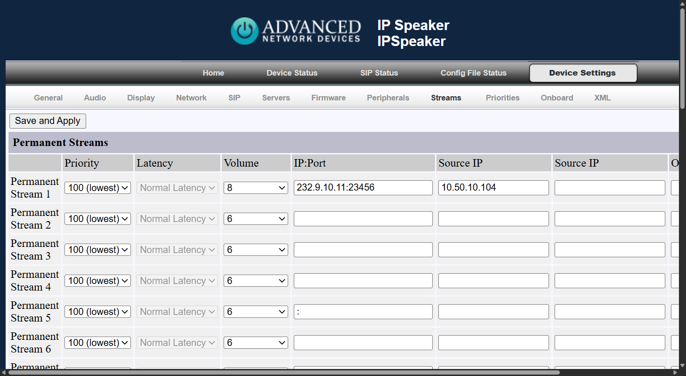

# Configure Advanced Network Devices IP Speakers to listen to Multicast RTP from Open Paging Server

Using a multicast RTP stream, you can use Advanced Network Devices IP Speakers on Open Paging Server.

---

## Add a Multicast RTP Stream

You can either create a new stream or use an existing one. Only streams of PCMU (μ-law) is supported on most Advanced Network Devices endpoints.

Each stream act's as a "zone". You can add multiple speakers on a single stream, use multiple streams on one speaker, etc.

It's recommended to zone out your speakers based on logical methods. Such as per building/facility, per floor, per area, etc.

You could use one speaker per stream, however this is not recommended for large setups. You can use the built-in SIP functionality if you need per-room calling.

### To create a new Multicast RTP stream

To create a new Multicast RTP stream in Open Paging Server, go to `Manage Endpoints` > `+` > `Multicast RTP`.

Enter a name, choose an unused Multicast Address and Even Port.

Ensure `PCMU` is selected as the codec.

Click `Add Multicast RTP`.

---

## Configure the speaker to listen

Go to the speaker's web interface using it's IP address in your web browser. The IP address is shown on clocks on first boot.

Go to `Device Settings` > `Streams` and add the new stream in `IP:Port` in `Permanent Streams`.

It's recommended you also configure the `Source IP` value to your Open Paging Server IP address for security.

Adjust the `Volume` if needed.

Click `Save and Apply` when finished. The device will reload.

