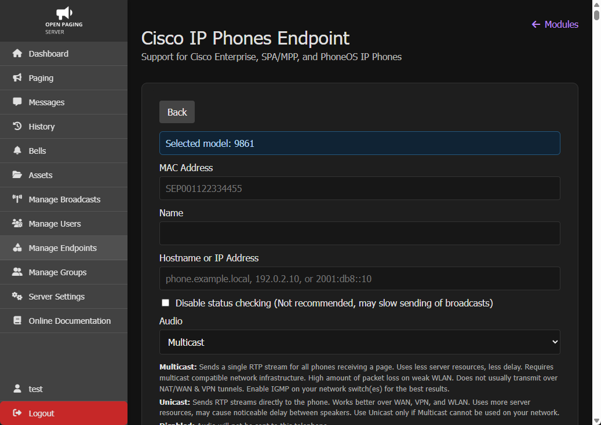

# Manually adding Cisco IP phones to Open Paging Server

Once you completed the [prerequisites](prerequisites.md), you can now start adding your phones into Open Paging Server.

To add Cisco IP Phones manually to Open Paging Server, you'll need their hostname or IP address. It's recommended to use a hostname since otherwise you'll need to change the IP address every time the telephone gets a new IP address from your DHCP server.

Go to `Manage Endpoints`, `+`, `Cisco IP Phones`, `Cisco Enterprise (SEP)`.

Select the model. This should be accurate, otherwise, certain features may not work properly.

In `MAC Address`, enter the full 12 digit MAC address starting with SEP.

In `Name`, enter a name which will be used to identify the device.

In `Hostname or IP Address` (or `IPv4 Address`), enter the hostname or IP address of the telephone.

If you select `Disable status checking` (or `Do not check status of device`), the status of the device will not be checked in the background. Open Paging Server will always attempt to send messages to this device even it it's offline or unable to receive messages. Disabling checking of status is not recommended unless you have **VERY** little resources because Open Paging Server won't start a broadcast until all devices are ready. If tons of unchecked devices are offline, it can delay a critical message for online devices by up to 5-15 seconds. As such, Leaving checking enabled ensures that broadcasts can be sent reliably.

See the settings page for information on other available settings.