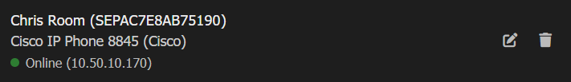
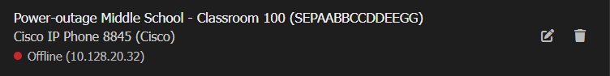

# Managing existing Cisco IP Phones on Open Paging Server

Once you have added a phone in Open Paging Server, you can go to `Manage Endpoints` to view it's status, edit, or delete it.

On the top of the page, you can click `Cisco IP Phones` to only view Cisco IP Phones. 

In list, you'll see your phones displayed along with it's name, MAC address, and IP address. 

`Online` is shown when the phone is fully reachable.

`No Auth URL` shows when there is no authentication URL configured. You should resolve this issue. See [prerequisites](prerequisites.md) for help.

`Offline` shows if the phone is not reachable or Web Access is disabled. If your phone is synced from UCM, it will likely not show an IP address because it's not registered to CUCM. If the phone is synced from UCM, shows an IP address and is offline, either `Web Access` is disabled, or Open Paging Server cannot reach it despite being registered to CUCM.

Click the trash icon to remove the phone. If the phone is synced, this will only hide the phone and it will be unavailable as an endpoint. You can go to `Manage Endpoint Modules` > `Cisco IP Phones` > `Show hidden synced phones` to unhide hidden phones.

For more information on available settings, refer to the settings page.

When you are done, click `Save Cisco Enterprise Endpoint`. The changes are now saved.